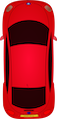
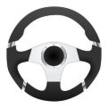
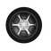

# User Documentation

- Overview
- Objective
- Mechanics - How to Play
    - Movement
    - Special Features
- Adjustability

## Overview

In this game the user controls a car driving forward on a road, with the primary objective of avoiding collisions and remaining on the road in order to travel in 1 kilometre increments as quickly as they can. Cars and motorbikes on the road coming toward the user from behind must be avoided, and upon a collision, a life is lost. Similarly, if the player travels off the road, a life is lost. Three lives are given to the player at the start of the game, and once the player has no lives left, the game is over.

## Objective
The objective of the game is to move as quickly as possible along the busy road, without crashing. The user must travel 1km within a given time, that is represented by the green countdown in the top middle of the screen. Upon completing a kilometre, the user must continue into the next kilometre, this time with one less second to complete it. As the game progresses, the user must manage to avoid crashing while simultaneously completing the kilometres faster and faster. Twenty seconds are given to complete the first kilometre.

## Mechanics - How to Play

### Movement

The user can control the car using the W,A,S,D keys of their keyboard

- **W** : accelerate
- **S** : decelerate 
- **A** : move left 
- **D** : move right 

   

The user should use these keys to avoid collisions with cars and to stay on the road, while also collecting [extra time](#special-features) and [boosts](#special-features) that they come across.
  

When the user moves the car left or right, the steering wheel in the bottom left turns in the direction of the motion.

 

### Special Features

- <ins><b>Boost:</b></ins>
  
  

  By collecting the ‘boost’, the car’s speed increases instantly by 10 m/s.

- <ins><b>Extra Time:</b></ins>
  
  

  When you collect the extra time element, you get en extra two seconds to travel the 1000 metres.
 
You can keep an eye out for these elements by looking at the grey navigation bar at the top of the screen. A red bar represents an incoming boost, and a blue bar represents an incoming extra time.

  

## Adjustability

To adjust screen size, frames per second, traffic density and initial lives, the user can go to [config.json file](/config.json), and edit the relevant figure.

   

 ***Good luck!***

 
  <a href="https://www.flaticon.com/free-icons/wasd" title="wasd icons">Wasd icons created by AB Design - Flaticon</a>
