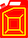
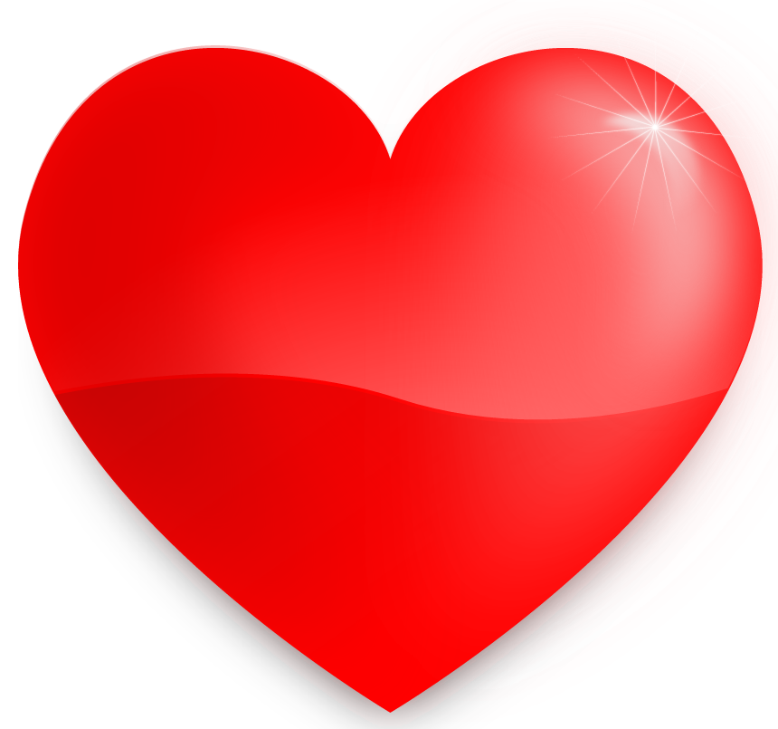

# User Documentation

## Overview

In this game the user controls a car driving forward on a road, with the primary objective of avoiding collisions and remaining on the road in order to travel as far as possible. Cars and motorbikes on the road coming toward the user must be avoided, and upon a collision, a life is lost. Similarly, if the player travels off the road, a life is lost. Three lives are given to the player at the start of the game, and once the player has no lives left, the game is over.

## Objective
The objective of the game is to travel as far as possible along the busy road, without crashing. (*THIS IS WHERE TIMER WILL BE EXPLAINED IF EXECUTED*)

## Mechanics - How to Play

### Movement
The user can control the car using the W,A,S,D keys of their keyboard

- **W** : accelerate
- **S** : decelerate 
- **A** : move left 
- **D** : move right 

The user should use these keys to avoid collisions with cars and to stay on the road, while also collecting [extra lifes](#special-features) and [boosts](#special-features)s that they come across.

When the user moves the car left or right, the steering wheel in the bottom left turns in the direction of the motion.

 

### Special Features

- <ins><b>Boost:</b></ins>
  
  

  By collecting the ‘boost’, the car’s speed increases instantly by 10 m/s.

- <ins><b>Extra Life:</b></ins>
  
  

  When you collect an extra life, you get an extra life!
 
You can keep an eye out for these elements by looking at the grey naviigation bar at the top of the screen. A red rectangle represents an incoming boost, and a blue bar represents an incoming extra life.

   

 ***Good luck!***

 
  <a href="https://www.flaticon.com/free-icons/wasd" title="wasd icons">Wasd icons created by AB Design - Flaticon</a>
